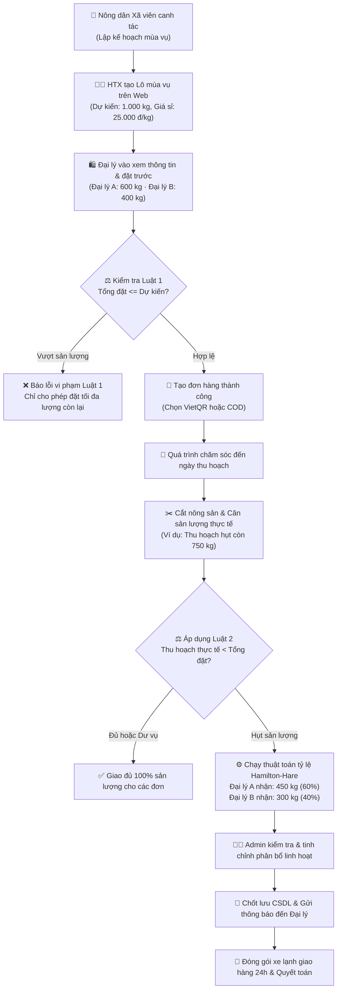

# 🌾 COOPAGRI — NỀN TẢNG ĐẶT TRƯỚC NÔNG SẢN THEO MÙA VỤ
### 🛒 eShop Blazor Server Application · Clean Architecture · Hợp Tác Xã Nông Nghiệp Số

> **ĐỒ ÁN HỌC PHẦN:** LẬP TRÌNH ỨNG DỤNG WEB (NÂNG CAO)  
> **ĐỀ TÀI SỐ 16:** *Xây dựng ứng dụng Web đặt trước nông sản theo mùa vụ kết nối Hợp tác xã với các chuỗi siêu thị, đại lý phân phối.*

---

## 👩‍🎓 THÔNG TIN SINH VIÊN & GIẢNG VIÊN HƯỚNG DẪN

| 📋 Thông Tin | 📌 Nội Dung Chi Tiết |
| :--- | :--- |
| 👤 **Họ và tên sinh viên:** | **Lê Thị Linh** |
| 🆔 **Mã sinh viên:** | **23K4080020** |
| 🎓 **Lớp sinh hoạt:** | **K57 Tin Học Kinh Tế** |
| 🏫 **Trường:** | **Trường Đại học Kinh tế – Đại học Huế (HCE)** |
| 🏢 **Khoa / Ngành đào tạo:** | **Hệ thống thông tin quản lý** |
| 📚 **Môn học:** | **Lập trình ứng dụng Web (Nâng cao)** |
| 👨‍🏫 **Giảng viên hướng dẫn:** | **TS. Hà Ngọc Long** |
| 📅 **Năm học / Học kỳ:** | **Học kỳ I — Năm học 2026 - 2027** |

---

## 🎯 MỤC TIÊU THỰC HIỆN ĐỀ ÁN

Thông qua việc nghiên cứu và xây dựng hoàn chỉnh ứng dụng **COOPAGRI (mô hình eShop mở rộng)**, đề án đạt được các mục tiêu trọng tâm:

1. 💻 **Thực hành lập trình Web hiện đại:** Làm chủ nền tảng **Blazor Server** và ngôn ngữ lập trình **C# trên .NET 8**, khai thác cơ chế cập nhật giao diện hai chiều theo thời gian thực (SignalR) không cần tải lại trang.
2. 🏛️ **Kiến trúc phần mềm chuẩn mực (Clean Architecture):** Làm quen và thành thạo kỹ năng tổ chức Solution gồm nhiều project riêng biệt (`CoreBusiness`, `UseCases`, `DataStore`, `WebApp`), giúp phân tách triệt để giữa tầng Nghiệp vụ, Giao diện và Truy xuất dữ liệu.
3. 💉 **Vận dụng Dependency Injection (DI):** Quản lý vòng đời dịch vụ (Lifetimes), giảm thiểu sự phụ thuộc trực tiếp (Loose Coupling) và tăng tính module hóa, dễ dàng bảo trì mở rộng.
4. 💾 **Truy xuất CSDL tối ưu với Dapper & SQL Server:** Thực hành thiết kế CSDL quan hệ chuẩn hóa, viết các câu lệnh truy vấn SQL hiệu năng cao và kiểm soát tính toàn vẹn giao dịch (`SqlTransaction` cấp độ `Serializable`).
5. ⚖️ **Mô hình hóa bài toán thực tế:** Giải quyết triệt để 2 bài toán lớn trong chuỗi cung ứng nông sản: **Kiểm soát sản lượng đặt trước (Luật 1)** và **Thuật toán phân bổ công bằng khi hụt mùa (Luật 2)**.
6. 💳 **Tích hợp thanh toán số VietQR 24/7:** Tạo mã QR ngân hàng động tự động điền sẵn số tiền và cú pháp chuyển khoản chính xác, kết hợp phương thức COD linh hoạt.
7. 🤖 **Ứng dụng Trí tuệ nhân tạo (AI Assistant):** Tích hợp Trợ lý AI hỏi đáp tri thức mùa vụ trực tiếp hỗ trợ giải đáp thắc mắc đại lý 24/7.

---

## 📌 GIỚI THIỆU DỰ ÁN COOPAGRI

**COOPAGRI** là ứng dụng thương mại điện tử chuyên biệt được phát triển nhằm kết nối trực tiếp giữa **Hợp tác xã nông sản sạch (HTX)** với các **Chuỗi siêu thị và Mạng lưới đại lý bán lẻ**.

Hệ thống giải quyết bài toán nhức nhối kinh điển của nông nghiệp Việt Nam: *"Được mùa mất giá, được giá mất mùa"* thông qua cơ chế **Đặt trước theo Lô mùa vụ (Pre-order Seasonal Harvest Batches)**:
- 🤝 **Bao tiêu ổn định:** Giá bán sỉ được cố định minh bạch ngay từ đầu vụ. Nông dân xã viên an tâm canh tác đúng quy chuẩn an toàn, đại lý chủ động kiểm soát chi phí đầu vào và nguồn cung chuẩn VietGAP.
- ⚖️ **Phân bổ tỷ lệ công bằng:** Khi thời tiết bất lợi dẫn đến sản lượng thu hoạch thực tế sụt giảm so với dự kiến, hệ thống tự động phân bổ theo tỷ lệ đặt hàng của từng đại lý, hạn chế tối đa tranh chấp thương mại.
- 🚚 **Giao hàng chuỗi lạnh khép kín:** Hỗ trợ quy trình đóng gói và vận chuyển xe lạnh 24 giờ giữ trọn độ tươi giòn của nông sản từ vườn đến kệ hàng.

---

## ✨ TỔNG QUAN CHỨC NĂNG CHÍNH

### 🛍️ 1. Phân Hệ Đại Lý & Khách Hàng (Customer / Dealer Portal)
- 🥬 **Xem danh sách nông sản & lô mùa vụ:** Duyệt danh mục nông sản sạch chuẩn VietGAP, GlobalGAP, OCOP với hình ảnh thực tế và thông tin chi tiết.
- 🔍 **Tìm kiếm & Lọc thông minh:** Tìm nhanh theo tên mặt hàng, nhóm danh mục (Rau củ quả, Trái cây đặc sản Huế, Nấm sạch, v.v.).
- 📦 **Xem chi tiết lô mùa vụ:** Nắm bắt sản lượng dự kiến toàn vụ, khối lượng còn lại khả dụng, ngày cắt dự kiến tại vườn, xã viên canh tác và đơn giá sỉ cố định.
- 🛒 **Quản lý giỏ hàng:** Thêm các lô nông sản vào giỏ, điều chỉnh số lượng đặt trước (kg), xóa sản phẩm khỏi giỏ, tự động ước tính tổng giá trị tiền hàng.
- 📝 **Đặt trước nông sản (Áp dụng Luật 1):** Hệ thống tự động kiểm tra khối lượng khả dụng theo thời gian thực, ngăn chặn tuyệt đối tình trạng đặt vượt quá sản lượng dự kiến của lô.
- 💳 **Lựa chọn phương thức thanh toán:**
  - **Chuyển khoản VietQR (Vietcombank):** Hệ thống sinh mã QR ngân hàng chuẩn NAPAS kèm số tài khoản `1041586535`, tên thụ hưởng `LE THI LINH`, số tiền chính xác và cú pháp `CK + SĐT`.
  - **Thanh toán tiền mặt khi giao hàng (COD):** Đồng kiểm chất lượng và khối lượng trước khi nhận hàng.
- 📋 **Lịch sử đơn đặt trước (`/my-orders`):** Theo dõi danh sách đơn hàng đã đặt, thông tin người nhận, trạng thái xử lý đơn và trạng thái thanh toán.
- 📊 **Theo dõi phân bổ thực tế (`/my-allocations`):** Xem sản lượng thực tế nhận được sau khi HTX hoàn tất thu hoạch và chạy phân bổ tỷ lệ.
- 💬 **Trợ lý ảo AI Mùa vụ 24/7:** Widget nổi góc dưới màn hình, tích hợp kho tri thức nông sản, trả lời chính xác về giá sỉ bao tiêu, chính sách vận chuyển xe lạnh và thuật toán phân bổ.
- ❓ **Trang Hỏi đáp (FAQ) & Chính sách:** Danh sách câu hỏi dạng Accordion xổ xuống trực quan (`/faq`) và trang chính sách minh bạch (`/policies`).

### 👨‍💼 2. Phân Hệ Quản Trị Viên (Admin Portal)
- 🔐 **Xác thực bảo mật:** Đăng nhập khu vực quản trị phân quyền kép (Admin / Dealer) với giao diện bo tròn tinh tế.
- 📊 **Bảng điều khiển tổng quan (Dashboard):** Thống kê số lượng đơn đặt mới, tổng doanh thu tạm tính, danh sách các lô đang mở thu hoạch và sản lượng cần bao tiêu.
- 👥 **Quản lý xã viên:** Tiếp nhận, cập nhật danh sách các hộ nông dân xã viên HTX, diện tích canh tác (ha), khu vực vùng trồng.
- 🥦 **Quản lý nông sản & hình ảnh:** Thêm mới, chỉnh sửa thông tin nông sản, tiêu chuẩn chất lượng (VietGAP/GlobalGAP) và đường dẫn ảnh sản phẩm hiển thị.
- 📅 **Quản lý lô thu hoạch mùa vụ:** Tạo lô mới, liên kết hộ xã viên, ấn định sản lượng dự kiến, ngày dự kiến thu hoạch và giá bao tiêu.
- 📑 **Tiếp nhận & Xử lý đơn hàng:** Xem danh sách toàn bộ đơn đặt trước, thông tin chi tiết từng đơn, cập nhật trạng thái vòng đời đơn hàng (*Chờ xác nhận, Đã xác nhận, Đang xử lý, Đang vận chuyển, Hoàn thành*) và trạng thái thanh toán (*Đã thanh toán / Chưa thanh toán*) trực tiếp tại bảng dữ liệu.
- ⚖️ **Thu hoạch & Phân bổ sản lượng linh hoạt (Áp dụng Luật 2):**
  - Nhập sản lượng thực tế khi cắt tại vườn.
  - Hệ thống tự động tính toán phân bổ ban đầu theo tỷ lệ công bằng và thuật toán phần dư lớn nhất (Largest Remainder / Hamilton-Hare).
  - Cho phép Admin **chỉnh sửa, can thiệp số lượng phân bổ** của từng đơn hàng trước khi bấm chốt chính thức, tạo sự linh hoạt trong thực tế quản lý.
  - Tự động ghi nhận lịch sử phân bổ và gửi thông báo trực tiếp đến tài khoản đại lý.
- 📢 **Quản lý thông báo phân bổ:** Phát hành và quản lý các thông báo thu hoạch công khai trên hệ thống.
- 🖼️ **Quản trị Banner & Thương hiệu:** Tùy biến hình ảnh banner giới thiệu, tên thương hiệu và logo HTX đồng bộ từ Header đến Footer.

---

## 🏗️ CẤU TRÚC DỰ ÁN (CLEAN ARCHITECTURE 4 TẦNG)

Dự án được tổ chức theo đúng mô hình chuẩn mực **Clean Architecture** và nguyên lý **Domain-Driven Design (DDD)**, phân tách thành các project độc lập:

```text
d:\LTUDWCK\
│
├── 🌿 AgriculturalCoop.CoreBusiness       (Tầng Nhân - Core Domain)
│   ├── Entities/                           # Các thực thể: Product, HarvestBatch, PreOrder, Allocation, Member, Dealer...
│   ├── Enums/                              # Trạng thái đơn, trạng thái thanh toán, phương thức thanh toán
│   ├── Exceptions/                         # Ngoại lệ nghiệp vụ: ExceededExpectedYieldException, PreOrderDomainException...
│   └── Services/                           # Nghiệp vụ cốt lõi: AllocationService (Thuật toán tỷ lệ & Largest Remainder)
│
├── ⚙️ AgriculturalCoop.UseCases           (Tầng Nghiệp Vụ Ứng Dụng - Application UseCases)
│   ├── PluginInterfaces/                   # Giao diện trừu tượng: IProductRepository, IPreOrderRepository, IAllocationRepository...
│   ├── PreOrders/                          # Ca sử dụng: Tạo đơn, kiểm tra giới hạn Luật 1, tra cứu đơn
│   ├── Allocations/                        # Ca sử dụng: Thực thi thuật toán phân bổ Luật 2, cập nhật phân bổ
│   ├── HarvestBatches/                     # Ca sử dụng: Tạo lô, cập nhật sản lượng thực tế, quản lý vòng đời lô
│   ├── Products/                           # Ca sử dụng: Danh mục, tìm kiếm, quản lý nông sản
│   ├── Members/                            # Ca sử dụng: Quản lý xã viên hợp tác xã
│   └── HomeBanners/                        # Ca sử dụng: Cấu hình banner và logo HTX
│
├── 💾 AgriculturalCoop.DataStore          (Tầng Lưu Trữ & Truy Xuất Dữ Liệu - Data Access Plugin)
│   ├── Sql/                                # Triển khai Repository bằng Dapper truy xuất SQL Server thật
│   │   ├── SqlDataAccess.cs                # Quản lý SqlConnection, SqlCommand và Transaction an toàn
│   │   └── SqlRepositories.cs              # Toàn bộ truy vấn SQL Server cho 8 bảng dữ liệu
│   └── InMemory/                           # Triển khai Mock Repository trong RAM phục vụ kiểm thử cô lập
│
├── 🌐 AgriculturalCoop.WebApp             (Tầng Trình Diễn - Presentation Layer Blazor Server)
│   ├── Components/
│   │   ├── Layout/                         # MainLayout, TopNavBar, AdminLayout, NavMenu
│   │   ├── Pages/                          # Các trang khách hàng: Home, Products, Batches, Cart, Policies, Faq
│   │   │   ├── Admin/                      # Quản trị viên: Dashboard, HarvestBatches, AllocationManager, PreOrders...
│   │   │   └── Account/                    # Xác thực: Login, Register, Logout
│   │   └── Shared/                         # Thành phần tái sử dụng: AiAssistantFloatingWidget...
│   ├── Services/                           # UserSessionState (quản lý phiên đăng nhập), Authentication State
│   ├── wwwroot/                            # Tài nguyên tĩnh: CSS, hình ảnh SVG nông sản, Icons
│   ├── Program.cs                          # Đăng ký Dependency Injection và cấu hình Pipeline
│   └── appsettings.Development.json        # Chuỗi kết nối SQL Server nội bộ
│
├── 🧪 AgriculturalCoop.RegressionTests     (Tầng Kiểm Thử Tự Động)
│   ├── Program.cs                          # 2.262 kịch bản kiểm thử thuật toán, giao dịch và phân quyền
│   └── TestCases/                          # Kiểm thử tính toán 1.000 trường hợp phân bổ ngẫu nhiên
│
└── 🗄️ Database/                            # Tập hợp 12 script SQL khởi tạo và nâng cấp cấu trúc CSDL
```

### 🧩 Vai trò cụ thể của từng thành phần
- **`CoreBusiness`:** Chứa thực thể dữ liệu và logic nghiệp vụ cốt lõi, hoàn toàn độc lập, không phụ thuộc vào bất kỳ thư viện hay cơ sở dữ liệu bên ngoài nào.
- **`UseCases`:** Đóng gói từng quy trình nghiệp vụ thành các Interactor độc lập tuân thủ nguyên lý Đơn nhiệm (Single Responsibility Principle).
- **`DataStore`:** Hoạt động như một Plugin truy xuất dữ liệu thông qua Interface của tầng `UseCases`, cho phép hoán đổi linh hoạt giữa SQL Server (môi trường vận hành) và InMemory (môi trường kiểm thử).
- **`WebApp`:** Project khởi chạy chính bằng Blazor Server, xử lý kết xuất giao diện phản hồi nhanh, bắt các sự kiện người dùng và gọi các UseCase tương ứng.

---

## 🛠️ BẢNG CÔNG NGHỆ SỬ DỤNG

| 💻 Công Nghệ | 📌 Phiên Bản / Thư Viện | 🎯 Vai Trò Trong Dự Án |
| :--- | :--- | :--- |
| **C#** | C# 12 | Ngôn ngữ lập trình chính, hướng đối tượng mạnh mẽ, hỗ trợ Pattern Matching và Records. |
| **.NET** | .NET 8.0 SDK (LTS) | Nền tảng phát triển ứng dụng hiệu năng cao của Microsoft. |
| **Blazor Server** | ASP.NET Core Blazor | Xây dựng Single Page Application (SPA) phản hồi thời gian thực qua kênh SignalR. |
| **Razor Components** | Razor Syntax | Xây dựng các UI Component tái sử dụng cao (`.razor`). |
| **SQL Server** | Microsoft SQL Server 2022 | Cơ sở dữ liệu quan hệ lưu trữ bền vững toàn bộ dữ liệu hệ thống. |
| **Dapper** | Dapper 2.1.89 | Micro-ORM siêu nhẹ, tối ưu hóa tốc độ thực thi câu lệnh SQL với độ trễ tối thiểu. |
| **Dependency Injection** | Microsoft.Extensions.DependencyInjection | Quản lý và cung cấp các dịch vụ xuyên suốt ứng dụng theo kiến trúc lỏng. |
| **VietQR API** | VietQR Standard (NAPAS) | Sinh mã QR thanh toán ngân hàng tự động điền đúng số tiền và nội dung chuyển khoản. |
| **QuickChart / QR Engine** | Image Rendering API | Tạo ảnh mã QR chất lượng cao phục vụ quét app Mobile Banking tức thì. |
| **Bootstrap** | Bootstrap 5.3 + Icons | Khung giao diện Responsive đa thiết bị kết hợp hệ thống biểu tượng trực quan. |
| **HTML5 / CSS3** | Modern CSS, Scoped CSS | Thiết kế giao diện sang trọng tông xanh lá nông nghiệp (#0d2818, #143823, #22c55e). |
| **Session & Auth** | Cookie Authentication | Cơ chế xác thực, phân quyền Cookie và duy trì phiên làm việc cho Admin & Đại lý. |

---

## 🔄 LUỒNG HOẠT ĐỘNG NGHIỆP VỤ (WORKFLOW)

Quy trình vận hành chuỗi đặt trước nông sản từ lúc gieo trồng đến khi giao nhận:



---

## ⚖️ CHI TIẾT HAI LUẬT NGHIỆP VỤ BẮT BUỘC

### 📌 Luật Nghiệp Vụ 1: Kiểm soát Giới hạn Đặt trước Lô Mùa Vụ
- **Quy tắc:** Tổng khối lượng đặt trước của tất cả các đại lý trên cùng một lô thu hoạch **không bao giờ được vượt quá sản lượng dự kiến** của lô đó:
  $$\sum_{i=1}^{n} \text{Quantity}_{\text{PreOrders}} \le \text{ExpectedYield}_{\text{Batch}}$$
- **Giải pháp kỹ thuật:** 
  - Giao dịch đặt hàng được bảo vệ bằng câu lệnh SQL kết hợp khóa gợi ý `UPDLOCK, HOLDLOCK` và cấp độ cô lập `SERIALIZABLE` để triệt tiêu hoàn toàn hiện tượng tranh chấp dữ liệu (Race Condition).
  - Validation 2 lớp: Client (kiểm tra tức thời giới hạn số nhập) và Server (ném ngoại lệ `ExceededExpectedYieldException` thân thiện khi có tranh chấp).

### 📌 Luật Nghiệp Vụ 2: Thuật toán Phân bổ Sản lượng Khi Hụt Mùa Vụ
- **Quy tắc:** Khi sản lượng thu hoạch thực tế nhỏ hơn tổng lượng đã đặt ($\text{ActualYield} < \sum \text{RequestedQuantity}$), HTX tự động phân bổ theo tỷ lệ công bằng:
  $$\text{AllocatedQuantity}_i = \left( \frac{\text{RequestedQuantity}_i}{\sum \text{RequestedQuantity}} \right) \times \text{ActualYield}$$
- **Xử lý phần dư (Largest Remainder / Hamilton-Hare):** 
  - Phần nguyên được làm tròn chính xác đến $0{,}01\text{ kg}$.
  - Phần lẻ thập phân còn thừa sẽ được ưu tiên cộng thêm cho đơn hàng có phần dư lớn nhất, đảm bảo tổng khối lượng phân bổ bằng chính xác 100% sản lượng thực tế thu hoạch:
  $$\sum_{i=1}^{n} \text{AllocatedQuantity}_i = \text{ActualYield}$$
- **Tính năng quản trị mở rộng:** Trước khi xác nhận chốt lưu, Admin có toàn quyền điều chỉnh số lượng thủ công theo thỏa thuận thực tế của HTX với từng đại lý.

---

## 💳 CHI TIẾT PHƯƠNG THỨC THANH TOÁN VIETQR

Hệ thống tích hợp cổng thanh toán **VietQR chuẩn NAPAS** tự động:
- **Ngân hàng thụ hưởng:** Ngân hàng TMCP Ngoại thương Việt Nam (**Vietcombank**)
- **Số tài khoản:** `1041586535`
- **Chủ tài khoản:** **LE THI LINH**
- **Cú pháp chuyển khoản tự động:** `CK + [Số điện thoại đại lý]` *(Ví dụ: `CK0981291299`)*
- **Cơ chế hoạt động:** Khi bấm chọn thanh toán VietQR tại bước hoàn tất đơn, hệ thống tự động sinh ảnh mã QR chứa đầy đủ số tài khoản, tên chủ tài khoản, số tiền phải thanh toán và nội dung chuyển khoản. Đại lý chỉ cần mở bất kỳ ứng dụng ngân hàng nào quét mã là toàn bộ thông tin được điền tự động 100%, không cần gõ thủ công.

---

## 🗄️ CƠ SỞ DỮ LIỆU SQL SERVER CỦA DỰ ÁN

Toàn bộ dữ liệu của hệ thống được lưu trữ và quản lý trực tiếp trong CSDL **Microsoft SQL Server**:

- **Tên Database:** `AgriculturalCoopDB`
- **Máy chủ kết nối:** `LAPTOP-1C71MGVB` (hoặc cấu hình lại trong file cấu hình)
- **Chuỗi kết nối (Connection String):**
  ```text
  Data Source=LAPTOP-1C71MGVB;Initial Catalog=AgriculturalCoopDB;Integrated Security=True;Encrypt=True;TrustServerCertificate=True;
  ```

### 📋 Danh sách các bảng dữ liệu chính trong SQL Server:
1. `Members`: Danh sách các hộ nông dân xã viên HTX (Họ tên, SĐT, Địa chỉ, Diện tích).
2. `Products`: Danh mục nông sản sạch (Tên, Đơn vị tính, Danh mục, Tiêu chuẩn VietGAP, Đường dẫn ảnh).
3. `HarvestBatches`: Các lô thu hoạch mùa vụ (Mã lô, Sản lượng dự kiến, Sản lượng thực tế, Ngày thu hoạch, Giá sỉ).
4. `Dealers`: Danh sách tài khoản đại lý đối tác liên kết với HTX.
5. `PreOrders`: Danh sách đơn đặt trước (Mã đơn, Ngày đặt, Người nhận, SĐT, Địa chỉ giao hàng, Phương thức thanh toán `PaymentMethod`, Trạng thái thanh toán `PaymentStatus`, Nội dung chuyển khoản `TransferContent`, Vòng đời đơn `OrderStatus`).
6. `PreOrderLines`: Chi tiết từng lô nông sản và khối lượng đặt trong đơn.
7. `Allocations`: Dữ liệu phân bổ sản lượng thực tế sau thu hoạch cho từng đơn.
8. `DealerNotifications`: Thông báo phân bổ tự động gửi đến tài khoản đại lý.
9. `UserAccounts`: Tài khoản đăng nhập hệ thống, mật khẩu được mã hóa an toàn (PBKDF2/SHA256).
10. `HomeBanners`: Cấu hình thông điệp banner và logo thương hiệu hiển thị trên website.

---

## 🚀 HƯỚNG DẪN CÀI ĐẶT & KHỞI CHẠY DỰ ÁN

### 1. Yêu cầu môi trường
- [.NET 8.0 SDK](https://dotnet.microsoft.com/download/dotnet/8.0)
- [Microsoft SQL Server](https://www.microsoft.com/sql-server/) (phiên bản 2019, 2022 hoặc SQL Server Express / LocalDB)
- [SQL Server Management Studio (SSMS)](https://learn.microsoft.com/sql/ssms/download-sql-server-management-studio-ssms) hoặc Azure Data Studio
- Visual Studio 2022 (từ v17.8 trở lên) hoặc Visual Studio Code / JetBrains Rider

### 2. Cấu hình CSDL trong dự án
Mở file `AgriculturalCoop.WebApp/appsettings.Development.json` và kiểm tra chuỗi kết nối:
```json
{
  "Logging": {
    "LogLevel": {
      "Default": "Information",
      "Microsoft.AspNetCore": "Warning"
    }
  },
  "ConnectionStrings": {
    "DefaultConnection": "Data Source=LAPTOP-1C71MGVB;Initial Catalog=AgriculturalCoopDB;Integrated Security=True;Encrypt=True;TrustServerCertificate=True;"
  }
}
```

### 3. Lệnh khởi chạy ứng dụng
Mở Terminal tại thư mục gốc của giải pháp (`d:\LTUDWCK`):

```powershell
# 1. Khôi phục các thư viện NuGet
dotnet restore AgriculturalCoop.sln

# 2. Biên dịch toàn bộ Solution
dotnet build AgriculturalCoop.sln

# 3. Khởi chạy ứng dụng Web Blazor Server
dotnet run --project AgriculturalCoop.WebApp --launch-profile http
```

Mở trình duyệt web và truy cập vào địa chỉ: **`http://localhost:5189`**

### 4. Tài khoản trải nghiệm hệ thống
- 👨‍💼 **Tài khoản Quản trị viên (Admin):**
  - **Tên đăng nhập / Email:** `admin@coopagri.vn` (hoặc `admin`)
  - **Mật khẩu:** `Admin@123`
- 🛍️ **Tài khoản Đại lý đối tác (Dealer):**
  - **Tên đăng nhập / Email:** `dealer1@gmail.com`
  - **Mật khẩu:** `Dealer@123`
  - *(Hoặc bấm nút **Đăng ký đại lý** trực tiếp trên website để tạo tài khoản mới)*

---

## 🧪 KẾT QUẢ KIỂM THỬ TỰ ĐỘNG (REGRESSION TESTS)

Dự án tích hợp bộ kiểm thử hồi quy toàn diện với **2.262 kịch bản kiểm thử tự động**, kiểm tra tính đúng đắn của toàn bộ nghiệp vụ:

- ✅ **Kiểm thử Thuật toán Phân bổ:** 1.000 kịch bản ngẫu nhiên bảo đảm tổng sản lượng phân bổ luôn bằng đúng 100% sản lượng thực tế thu hoạch, sai số bằng 0.
- ✅ **Kiểm thử Luật 1 & Khóa đồng thời:** Giả lập nhiều tiến trình đặt hàng cùng lúc trên cùng 1 lô để kiểm tra khả năng khóa dữ liệu an toàn.
- ✅ **Kiểm thử Bảo mật & Cookie:** Xác thực mật khẩu mã hóa một chiều, phân quyền giữa Admin và Dealer.
- ✅ **Kiểm thử CSDL SQL Server:** Tự động tạo và rollback giao dịch kiểm thử trên CSDL thật.

Chạy lệnh kiểm thử:
```powershell
dotnet run --project AgriculturalCoop.RegressionTests --no-build -- --sql
```

**Kết quả thực thi:**
```text
SQL checks passed; allocation, notification and banner test changes rolled back; no business data changes committed.
Passed 2262 regression checks.
```

---

## 🏆 KẾT LUẬN & ĐÁNH GIÁ ĐỒ ÁN

Đồ án **COOPAGRI** đã giải quyết xuất sắc yêu cầu của bài toán **Đề tài số 16: Hợp tác xã Nông sản - Đặt trước theo Mùa vụ**:
- Xây dựng hoàn chỉnh kiến trúc 4 tầng chuẩn **Clean Architecture** trên nền tảng **Blazor Server .NET 8**.
- Vận dụng linh hoạt **C#**, **Dapper**, **SQL Server** và **Dependency Injection**.
- Giao diện người dùng sang trọng, responsive, bo tròn mềm mại, thân thiện trên mọi thiết bị.
- Tích hợp các giải pháp công nghệ thời thượng: **Thanh toán VietQR tự động**, **Trợ lý AI Mùa vụ 24/7**, và bộ kiểm thử **2.262 test cases**.

---

*COOPAGRI — Dự Án Capstone Môn Lập Trình Ứng Dụng Web (Nâng Cao) — Tác Giả: Lê Thị Linh (23K4080020) — GV Hướng Dẫn: TS. Hà Ngọc Long.*
